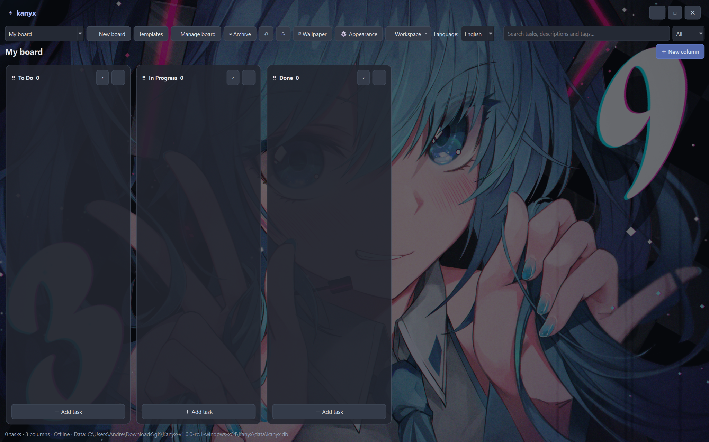

# Kanyx 1.0.2

**A minimalist, portable, offline-first Kanban board for Windows and Linux.**

Built with **Python, PySide6 (Qt 6) and SQLite**. No accounts, cloud service or network connection required. Designed for a single workspace on a USB stick.

> **Latest stable release: [v1.0.2](https://github.com/zehnzwanzig/kanyx/releases/tag/v1.0.2).** Windows x64 is available; the Linux x64 build is **experimental and has not been GUI-tested on a target Linux machine**.
>
> [Download Kanyx](https://github.com/zehnzwanzig/kanyx/releases/tag/v1.0.2) · [Project website](https://zehnzwanzig.github.io/kanyx/) · [Report a bug](https://github.com/zehnzwanzig/kanyx/issues/new?template=bug_report.yml) · [Browse issues](https://github.com/zehnzwanzig/kanyx/issues) · [Keyboard Shortcuts](docs/KEYBOARD_SHORTCUTS.md)

<p align="center">
  
</p>
<p align="center">
  <sub>Dark mode, translucent columns and customizable wallpapers.</sub>
</p>

## What's new in 1.0.2

Version 1.0.2 focuses on robustness: safer attachment handling, all-or-nothing card saves, clearer warnings for missing files, literal search for special characters, safer handling of duplicate tags, and a choice to delete or keep attachments when deleting a card. [Release notes](https://github.com/zehnzwanzig/kanyx/releases/tag/v1.0.2).

## Features

- Boards, reorderable/collapsible columns, draggable task cards
- Tags, priorities, due dates, checklists, attachments, archive and duplication
- Markdown description preview, card colors, checklist progress, board templates
- Search, keyboard shortcuts and session undo/redo for selected operations
- Custom wallpaper, adjustable brightness/column opacity/text size
- Thirteen UI languages: English (default), German, Spanish, French, Japanese, Korean, Italian, Simplified Chinese, Brazilian Portuguese, Polish, Russian, Hindi and Arabic
- Complete `.kanyx` workspace export/import with attachment files; database backups and integrity checks

## Download and run — Windows x64

1. Open [GitHub Releases](https://github.com/zehnzwanzig/kanyx/releases/tag/v1.0.2) and download **`Kanyx-v1.0.2-windows-x64.zip`** from **Assets**.
2. Extract the **entire archive** to a writable folder or USB stick.
3. Open the extracted `Kanyx/` directory and run `Kanyx.exe`.

**Keep `Kanyx.exe` and the `_internal/` directory together.** Kanyx is distributed as a portable *one-directory* application, not a standalone EXE. You do not need to install Python or Qt separately. On first launch, Kanyx creates a `data/` directory alongside the executable.

> Windows SmartScreen or corporate security policies may warn about unsigned executables. This repository does not provide code signing.

## Download and run — Linux x64 (experimental)

The experimental Linux release has not yet been GUI-tested on a real target machine. It may require extra desktop libraries, including `libxcb-shape.so.0`.

1. Download **`Kanyx-v1.0.2-linux-x64-experimental.zip`** from [Assets](https://github.com/zehnzwanzig/kanyx/releases/tag/v1.0.2).
2. Extract the entire archive, open the `Kanyx-linux/` directory, and run:

```bash
chmod +x Kanyx-linux
./Kanyx-linux
```

Linux portability is not guaranteed across distributions: glibc, Qt desktop dependencies, and `noexec` USB mounts can prevent execution. If the USB mount is `noexec`, copy the **whole extracted directory** to an executable location and keep a backup of your workspace; this changes the location of the `data/` directory used by Kanyx.

## Portable workspace, updates and backups

Kanyx stores its database, attachments, wallpapers and backups in `data/` **next to the running executable** (or next to `db.py` when run from source). When updating, **keep the existing `data/` directory** and replace the application files. Back up your workspace before replacing anything. Older `data/pyban.db` databases are recognized; do not rename or remove them without making a backup.

Use **Workspace → Export workspace** to write a full `.kanyx` backup (includes attachments). **Import workspace replaces the entire current workspace**, and creates a rollback copy of the previous data folder. A database-only backup does *not* include attachments. Exported workspaces are **not encrypted**.

Do not use the same workspace simultaneously from multiple instances. A multi-instance lock is intentionally not implemented.


## Bugs, feedback and contributions

Found a bug or have an idea? Open a [GitHub Issue](https://github.com/zehnzwanzig/kanyx/issues/new/choose). For bug reports, use the [Bug Report template](https://github.com/zehnzwanzig/kanyx/issues/new?template=bug_report.yml) and include your operating system, Kanyx version, steps to reproduce, and what you expected to happen.

**Do not attach personal workspace databases, exports, attachments, or other private data** to public issues. Screenshots should be checked for sensitive information before uploading. For contributions, see [CONTRIBUTING.md](CONTRIBUTING.md).

## Run from source

Python 3.11+ recommended for development (other versions may work). From the project directory:

```bash
python -m venv .venv
# Activate your virtual environment according to your OS
python -m pip install -r requirements.txt
python main.py
```

On Windows you may run `.venv\Scripts\python.exe main.py` without activating the environment.

## Build locally

For distribution candidates, use `scripts\build_windows_release.bat` on Windows or `bash scripts/build_linux_release.sh` on Linux. These create complete `onedir` folders with separate Qt libraries and the included license notices:

- Windows: `dist/Kanyx/` (launcher: `Kanyx.exe`)
- Linux: `dist/Kanyx-linux/` (launcher: `Kanyx-linux`)

The older `scripts/build_windows.bat` and `scripts/build_linux.sh` create single-file executables for local experimentation, **not** the recommended public binary packages. Cross-compilation is not supported by these scripts.

## Tests and releases

```bash
python -m unittest discover -s tests -v
```

CI runs unit tests on Windows and Linux. Tagged builds and manually dispatched builds upload candidate directories as GitHub Actions artifacts; **GitHub Releases are published separately**. The current stable release is [v1.0.2](https://github.com/zehnzwanzig/kanyx/releases/tag/v1.0.2). The first stable release was [v1.0.0](https://github.com/zehnzwanzig/kanyx/releases/tag/v1.0.0). Earlier pre-releases are still available under [GitHub Releases](https://github.com/zehnzwanzig/kanyx/releases).

See [CHANGELOG.md](CHANGELOG.md), [CONTRIBUTING.md](CONTRIBUTING.md), [SECURITY.md](SECURITY.md), and [previous version documentation](docs/HISTORY_AND_FEATURES.md).

## Known limitations

- Single-user offline workspace; no cloud sync or multi-user collaboration.
- Undo/redo does not cover every editor operation or permanent deletion.
- Interface scaling adjusts text; not all controls scale proportionally.
- Linux builds depend on the target desktop and libraries; real-world GUI testing is still required.

## License and redistribution

Kanyx's own source code is under the [MIT License](LICENSE). **PySide6/Qt and other dependencies are separately licensed.** See [third-party notices](THIRD_PARTY_NOTICES.md), [Qt source distribution notes](docs/THIRD_PARTY_SOURCES.md), and the [release compliance checklist](docs/RELEASE_COMPLIANCE.md).

The stable release provides separately downloadable Qt/PySide6 source archives and bundled license notices. LGPL corresponding-source, third-party attribution, and modified-library requirements still require independent verification. Distribute the **complete** portable binary folders, not just the executable.
